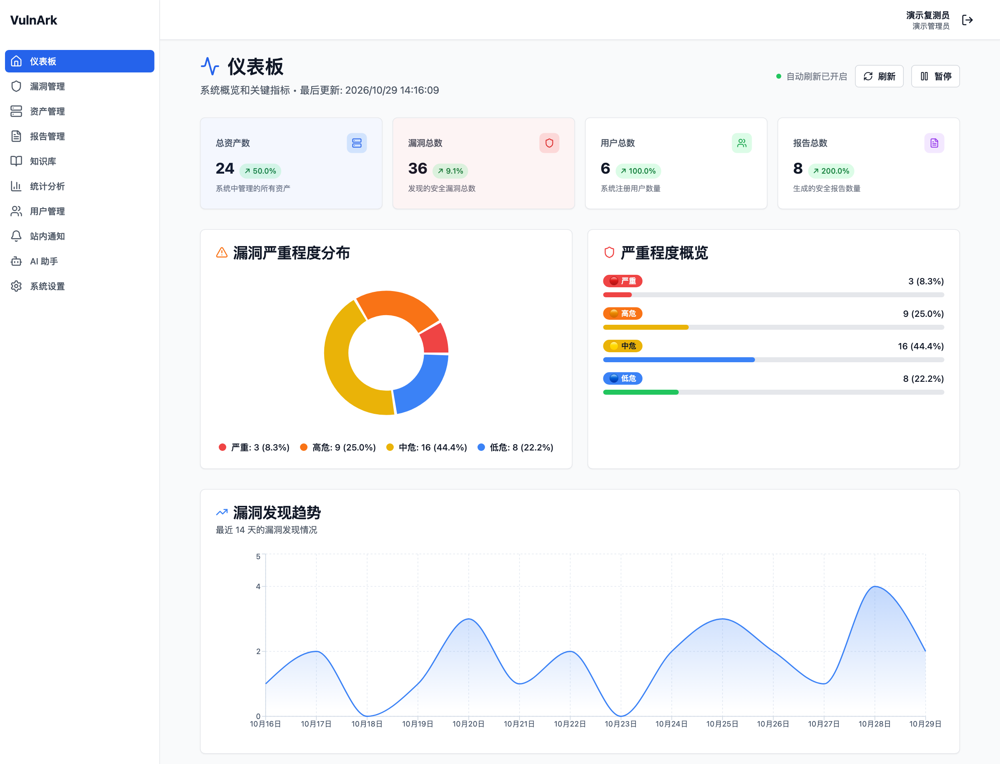
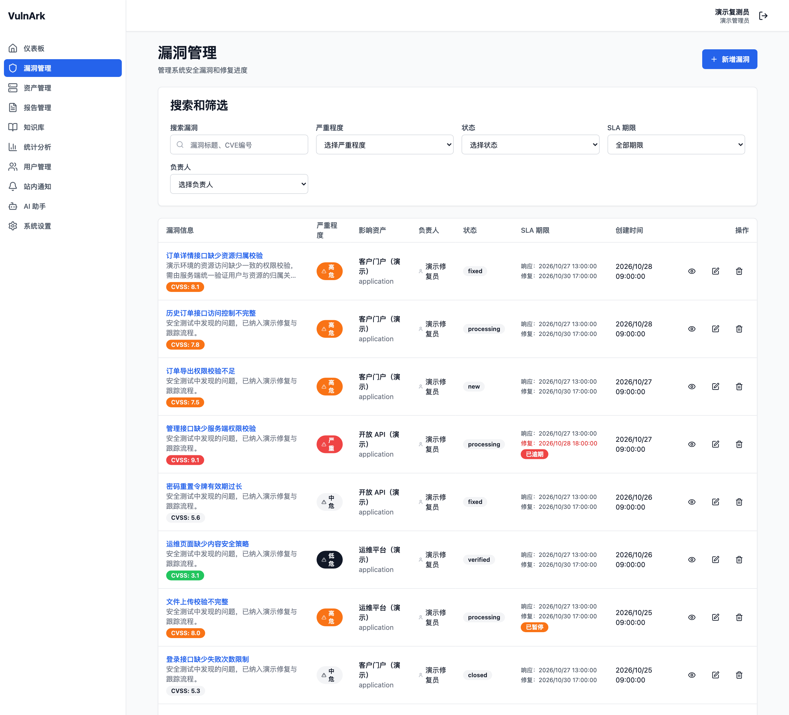
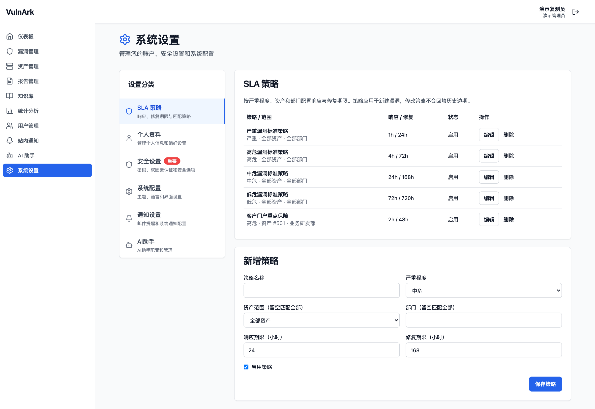
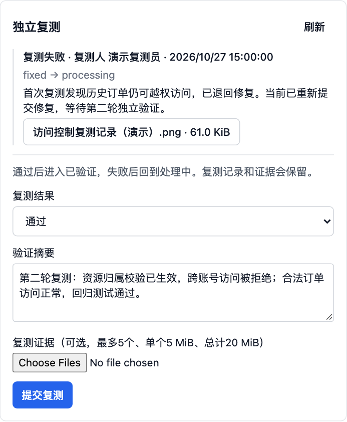
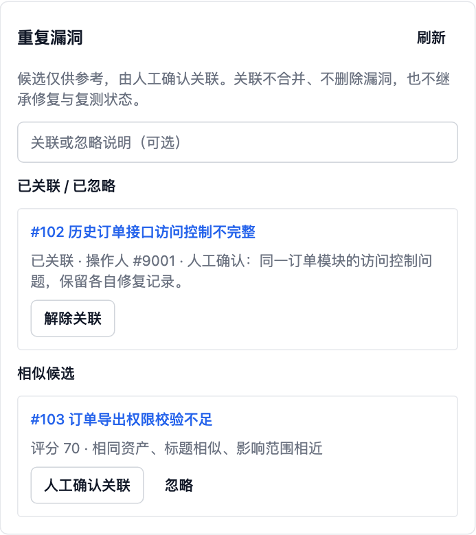

# VulnArk · 漏洞管理平台

VulnArk 用于集中管理安全漏洞、关联资产和修复进度，将漏洞录入、分派、SLA 跟踪、独立复测和关闭串成可追溯的工作流程。

项目采用 Go 后端与 React 前端。前端资源嵌入后端可执行文件，部署时只需运行应用、连接 MySQL，并配置私有文件存储目录。

## 界面预览

以下截图来自项目实际前端，使用本地固定演示数据，仅展示界面与操作入口，不包含真实业务信息。点击图片可查看原图。

### 仪表盘

集中查看资产、漏洞、用户与报告数量，以及漏洞严重程度分布和发现趋势。

[](assets/screenshots/dashboard.png)

### 漏洞管理

按严重程度、状态和 SLA 期限筛选漏洞，查看影响资产、负责人、CVSS 评分及逾期提示。

[](assets/screenshots/vulnerabilities.png)

### SLA 策略

按严重程度、资产与部门配置响应、修复期限，支持通用规则和重点资产策略。

[](assets/screenshots/sla-policies.png)

### 独立复测与重复提示

以下为漏洞详情中的功能面板。复测面板保留历史结果、摘要及证据入口；重复提示展示匹配理由、评分和人工关联操作。

| 独立复测 | 重复漏洞提示 |
| --- | --- |
| [](assets/screenshots/retest.png) | [](assets/screenshots/duplicates.png) |

## 核心功能

| 模块 | 功能说明 |
| --- | --- |
| 漏洞管理 | 漏洞录入、CVE/CNVD 编号、OWASP 分类、CVSS 评分、截图、分派和操作时间线 |
| 风险优先级 | 综合 CVSS、EPSS、CISA KEV、资产重要性和暴露面计算 0-100 风险评分，划分 P1-P4 档位并推荐修复期限；列表按评分排序筛选，详情展示每个因子的贡献 |
| 资产管理 | 维护资产类型、部门、负责人、重要性和暴露面（是否对外、网络区域），支持批量导入与风险分析 |
| SLA 管理 | 按严重程度、资产和部门配置响应与修复期限，支持暂停、恢复及逾期升级提醒 |
| 独立复测 | 保存复测结果、摘要和证据；验证通过后关闭，失败时退回修复 |
| 重复漏洞提示 | 提供候选匹配理由与评分，支持人工关联、解除和个人忽略/恢复 |
| 报告管理 | 上传、审核、归档、预览和鉴权下载报告 |
| 知识库 | 管理安全知识、标签和文章模板 |
| 统计分析 | 查看漏洞趋势、修复情况、资产风险，导出 CSV |
| 账号与权限 | 角色授权、JWT 认证、TOTP 双因素认证、恢复码和撤销全部会话 |
| 通知与审计 | 站内通知、漏洞详情跳转、通知偏好和操作审计 |
| AI 助手 | 配置 AI 提供商、管理对话历史，保护同一会话的并发写入 |

上传文件通过认证接口访问，不公开内部存储路径。删除文件采用持久化清理任务，失败或重启后可继续处理。页面与设置面板按需加载。

## 技术栈

- **后端**：Go、Gin、GORM、MySQL、JWT、Viper、Logrus。
- **前端**：React、TypeScript、Vite、Tailwind CSS。
- **API 调试**：Swagger。
- **测试与构建**：Go Test、SQLite 测试库、Bun、ESLint、GitHub Actions。

## 环境要求

| 组件 | 要求 |
| --- | --- |
| Go | 1.27.3+，仓库工具链为 1.27.3 |
| MySQL | 8.0+，用于应用运行 |
| Bun | 用于前端依赖与构建，CI 使用 1.4.4 |
| C 编译器 | 运行 SQLite 相关测试时需要，CGO 须启用 |

SQLite 用于自动化测试，应用生产入口连接 MySQL。

## 快速开始

### 1. 获取代码并构建前端

```sh
git clone https://github.com/VpSanta33/VulnArk.git
cd VulnArk

cd frontend
bun install --frozen-lockfile
bun run build
cd ..
```

前端依赖以 `frontend/bun.lock` 锁定。构建结果写入 `backend/web/`，随后由 Go 嵌入可执行文件；修改前端后需要重新构建前后端。

### 2. 创建数据库

使用 MySQL 管理连接执行：

```sql
CREATE DATABASE vulnark
  CHARACTER SET utf8mb4
  COLLATE utf8mb4_unicode_ci;
```

为应用配置专用数据库账号，并授予目标库所需权限。应用不会自动建库。生产环境建议将迁移账号和运行账号分开，避免应用以 root 身份运行。

### 3. 配置应用

从仓库根目录将[配置模板](backend/configs/config.example.yaml)复制到私有目录：

```sh
mkdir -p "$HOME/.config/vulnark"
cp backend/configs/config.example.yaml "$HOME/.config/vulnark/config.yaml"
chmod 600 "$HOME/.config/vulnark/config.yaml"

export VULNARK_CONFIG="$HOME/.config/vulnark/config.yaml"
```

编辑数据库连接和存储目录，并填写以下配置；也可以通过同名环境变量覆盖：

| 配置项 | 环境变量 | 说明 |
| --- | --- | --- |
| `database.password` | `DATABASE_PASSWORD` | 至少 12 字节的数据库密码 |
| `jwt.secret` | `JWT_SECRET` | 至少 32 字节的独立随机签名密钥 |
| `security.mfa_encryption_key` | `SECURITY_MFA_ENCRYPTION_KEY` | 恰好 32 个原始字节的独立 MFA 加密密钥 |
| `storage.local_path` | `STORAGE_LOCAL_PATH` | 私有上传目录，部署时使用绝对路径 |
| `server.host` | `SERVER_HOST` | 默认 `127.0.0.1` |
| `server.port` | `SERVER_PORT` | 默认 `8080` |

JWT 与 MFA 密钥必须不同，不能使用公开值或占位符。MFA 配置直接使用原始字节串，不会自动解码 hex/base64。请备份密钥，不要将私有配置或真实凭据提交到仓库。

环境变量优先于配置文件，显式空值也会覆盖文件值。指定 `VULNARK_CONFIG` 后，文件读取失败会终止启动。

### 4. 初始化并启动

```sh
cd backend
go mod download

go run ./cmd -migrate
go run ./cmd
```

`-migrate` 执行显式迁移并退出。普通启动只检查迁移状态，不自动修改表结构。

首次初始化空库时会创建 `admin`，随机密码保存在**迁移工作目录**的 `admin_credentials.txt` 中，文件权限为 `0600`。没有固定默认密码。首次登录后修改密码，并妥善清理凭证文件；已有用户不会被覆盖。

启动后可访问：

- **应用界面**：<http://localhost:8080>
- **健康检查**：<http://localhost:8080/health>
- **Swagger**：<http://localhost:8080/swagger/index.html>

## 使用流程

### 漏洞修复与复测

```text
录入漏洞 → 分派负责人 → 处理修复 → 提交已修复 → 独立复测 → 验证通过 → 关闭
                                     ↑            │
                                     └── 复测失败 ┘
```

- 复测通过使漏洞从 `fixed` 进入 `verified`，随后可关闭。
- 对 `fixed`、`verified` 或 `closed` 的漏洞复测失败，会退回 `processing`。
- 普通编辑不能直接标记已验证，也不能跳过复测关闭漏洞。
- 当前修复负责人不能自验。复测还会检查操作者的权限和目标漏洞访问范围。
- 复测结果、证据、状态、SLA、时间线和结果通知在同一事务内提交。

截图与复测图片证据最多 5 个，单个不超过 5 MiB，总计不超过 20 MiB。服务端校验真实图像内容、尺寸与像素数；配置可以进一步收紧限制。

### SLA 与逾期提醒

在 **设置 → SLA 策略** 中管理策略，漏洞列表可筛选 SLA 状态，详情可查看期限及暂停/恢复计时。

| 严重程度 | 默认响应期限 | 默认修复期限 |
| --- | --- | --- |
| 严重 | 1 小时 | 24 小时 |
| 高危 | 4 小时 | 72 小时 |
| 中危 | 24 小时 | 168 小时 |
| 低危 | 72 小时 | 720 小时 |

策略优先匹配资产，其次部门，最后通用规则。新漏洞保存策略快照，修改策略和重新分派不会重置已有期限。历史漏洞没有期限时不会自动回填或判为逾期。

后台每分钟分批检查，通知负责人或发现人；逾期 24 小时增加资产负责人，72 小时增加活跃管理员。提醒持久化去重并遵守站内推送偏好，**不会自动发送邮件或修改漏洞状态**。

### 基于风险的漏洞优先级

只按 CVSS 或厂商评级排序，会把“技术上严重但几乎不会被利用”的漏洞排在“正在被利用的漏洞”或“对外核心系统上的渗透测试发现项”前面。风险评分把技术严重性、真实利用情况和业务影响放在一起衡量，用来回答“先修哪一条、为什么”。

#### 评分模型

每条漏洞的风险评分为 0-100，由五个因子加权得出。每个因子先折算成 0-1 的取值：

| 因子 | 数据来源 | 取值 | 默认权重 |
| --- | --- | --- | --- |
| CVSS 技术严重性 | 漏洞的 CVSS 基础分 | CVSS ÷ 10；未填写时按严重等级估算（严重 9.5、高危 8.0、中危 5.5、低危 2.0） | 30 |
| EPSS 利用可能性 | [FIRST EPSS](https://www.first.org/epss/) 未来 30 天被利用概率 | 对数刻度：0.1% 及以下记 0，1% 记 1/3，10% 记 2/3，100% 记 1 | 20 |
| CISA KEV | [CISA 已知被利用漏洞目录](https://www.cisa.gov/known-exploited-vulnerabilities-catalog) | 收录记 1，未收录记 0 | 15 |
| 资产重要性 | 资产的重要程度 | 高 1.0、中 0.6、低 0.3 | 20 |
| 暴露面 | 资产的“对外暴露”和“网络区域” | 0.6 × 是否对外 + 0.4 × 区域敏感度（OT 1.0、生产 0.8、DMZ 0.6、内部办公 0.4、测试 0.2） | 15 |

```text
风险评分 = Σ（因子取值 × 有效权重）
有效权重 = 该因子权重 ÷ 所有“有数据”因子的权重之和 × 100
```

- **缺数据的因子不计分，而不是记 0。** 没有 CVE 编号的漏洞（如渗透测试发现项）没有 EPSS 和 KEV，只用 CVSS、资产重要性和暴露面三项计分，它们的权重按比例放大到 100。有 CVE 但本地还没有 EPSS 分数、或 KEV 目录尚未同步时同样处理，“未知”不会被当作“安全”。
- EPSS 用对数刻度，因为绝大多数 CVE 的 EPSS 低于 1%，线性折算会让这一项几乎没有区分度。
- 评分按档位阈值划分优先级，再应用 **KEV 保底规则**：收录于 KEV 的漏洞至少为设定档位（默认 P2）。

| 档位 | 默认最低评分 | 默认建议修复期限 |
| --- | --- | --- |
| P1 紧急 | 80 | 24 小时 |
| P2 高 | 60 | 72 小时 |
| P3 中 | 40 | 168 小时 |
| P4 低 | 低于 P3 | 720 小时 |

例：对外网银系统上的 Log4Shell（CVSS 10，EPSS 99.99%，KEV 收录）评分 98.8，为 P1；同一系统上渗透测试发现的越权漏洞（CVSS 8.1，无 CVE）评分 89.4，为 P1；内网 OA 上的 CVE-2022-41741（CVSS 7.8，EPSS 0.81%，未收录 KEV）评分 43.9，为 P3。

#### 在界面中使用

- **漏洞列表** 默认按风险评分从高到低排序（未评分的漏洞排在最后），可按风险档位筛选、只看 KEV 收录漏洞，也可切回按创建时间排序。点击评分可直接打开评分构成。
- **漏洞详情 → 风险评分** 列出每个因子的原始值、有效权重和实际贡献分，合计等于总分；注明哪些因子因无数据未参与计分、是否触发了 KEV 保底，并把档位建议的修复期限与当前 SLA 修复期限对比。建议期限不会自动改写已有 SLA 期限。
- **资产管理** 中维护“对外暴露”和“网络区域”。修改资产的重要性或暴露面后，该资产上的漏洞会自动重算。
- **设置 → 风险评分**（需要 `risk:manage`）调整五个因子的权重（相对值，无需合计 100）、三个档位阈值、各档建议修复期限和 KEV 保底档位，并查看情报缓存状态、立即同步或重算全部评分。保存配置后立即按新模型重算全部漏洞。

配置约束：权重为 0-100，且 CVSS、资产重要性、暴露面三项不能同时为 0（否则无 CVE 的漏洞无法计分）；阈值须满足 0 < P3 < P2 < P1 ≤ 100；建议期限为整数小时且 P1 ≤ P2 ≤ P3 ≤ P4。

#### EPSS 与 KEV 的同步和缓存

评分只读取本地缓存表（`threat_intel_epss`、`threat_intel_kev`），录入、编辑、查询漏洞时都不会访问外部接口。

- 后台任务在启动时和之后每 10 分钟检查一次：KEV 目录每个同步周期整体刷新一次；EPSS 只查询平台中已录入的 CVE 编号，按每批 80 个请求，超过同步周期的才刷新。录入带新 CVE 的漏洞会触发一次提前同步。
- 同步失败时保留原有缓存，记录错误并按指数退避重试（上限为一个同步周期）。KEV 目录为空、不是合法 JSON 或条目数骤减一半以上时视为异常，不会替换缓存。
- 设置页显示每个数据源的条目数、数据版本、最近成功时间和最近错误；超过两个同步周期没有成功会标为“数据较旧”。
- 只有格式正确的 CVE 编号会发往 EPSS 接口，其他漏洞信息不会离开平台。

部署配置（`config.yaml` 或同名环境变量，如 `RISK_INTEL_ENABLED`）：

```yaml
risk_intel:
  enabled: true                   # 离线环境设为 false，评分只用 CVSS、资产重要性和暴露面
  epss_api_url: "https://api.first.org/data/v1/epss"
  kev_feed_url: "https://www.cisa.gov/sites/default/files/feeds/known_exploited_vulnerabilities.json"
  sync_interval_hours: 24         # 1-720
  request_timeout_seconds: 30     # 5-120
```

同步沿用平台的出站限制：只访问这两个地址所在的主机，不读取代理环境变量，默认拒绝内网和保留地址。使用内网镜像，或本机代理以 fake-IP 模式把域名解析到 `198.18.0.0/15` 时，需要在 `security.outbound_private_origins` 中明确授权对应来源，例如 `["https://api.first.org", "https://www.cisa.gov"]`。

#### 接口

| 接口 | 权限 | 说明 |
| --- | --- | --- |
| `GET /api/v1/vulnerabilities?sort_by=risk_score&sort_order=desc&risk_priority=P1&kev_only=true&min_risk_score=60` | `vuln:read` | 列表排序与筛选，响应含 `risk_score`、`risk_priority`、`risk_epss`、`risk_kev` |
| `GET /api/v1/vulnerabilities/{id}/risk` | `vuln:read` | 评分构成与建议期限 |
| `GET /api/v1/risk/config` | `vuln:read` 或 `risk:manage` | 当前模型与默认值 |
| `PUT /api/v1/risk/config` | `risk:manage` | 保存模型并重算全部漏洞 |
| `POST /api/v1/risk/recalculate` | `risk:manage` | 按当前模型重算 |
| `GET /api/v1/risk/intel/status` | `vuln:read` 或 `risk:manage` | 情报缓存状态 |
| `POST /api/v1/risk/intel/sync` | `risk:manage` | 立即同步；同步进行中返回 409 |

### 重复漏洞处理

创建表单根据资产、CVE/CNVD、标题和影响范围提示候选及匹配理由。用户可以确认关联、解除关联，或按个人维度忽略和恢复候选。

关联保留两条独立漏洞记录，不自动合并或删除。创建成功后若关联失败，只重试关联，避免重复录入。

### 权限说明

| 操作 | 所需权限 |
| --- | --- |
| 查看漏洞及相关记录 | `vuln:read`，敏感记录另校验访问范围 |
| 创建、编辑、删除漏洞 | `vuln:create` / `vuln:update` / `vuln:delete` |
| 分派漏洞 | `vuln:assign` |
| 提交复测 | `vuln:read` + `vuln:verify` |
| 重复关联、忽略及恢复 | `vuln:read` + `vuln:update` |
| 管理 SLA 策略 | `sla:manage` |
| 调整风险评分模型、手动同步情报 | `risk:manage` |
| 暂停、恢复单漏洞 SLA | `sla:manage` + `vuln:read` |
| 管理用户或角色资料 | `user:manage` / `role:manage` |
| 分配用户角色、修改角色权限 | 对应管理权限 + `system:permission` |
| 导出统计 | `analytics:read` + `analytics:export`；用户统计另需 `user:manage` |

权限支持 `*` 和 `module:*`，兼容历史 `vulnerability:` 前缀。迁移只补充权限目录，不自动扩大已有自定义角色的授权。

## 部署与升级

前端构建完成后，在 `backend/` 执行：

```sh
go build -o vulnark ./cmd
VULNARK_CONFIG=/absolute/path/to/config.yaml ./vulnark -migrate
VULNARK_CONFIG=/absolute/path/to/config.yaml ./vulnark
```

前端资源已嵌入二进制。部署时仍需提供配置文件、MySQL 和私有上传目录；配置和存储目录使用绝对路径。CSV 导出需要在服务工作目录创建私有 `exports/` 临时目录，工作目录须可写。

对外部署时按需调整监听地址，通过反向代理提供 HTTPS，只信任实际代理的 IP/CIDR，并配置明确的 CORS 来源。不要将 `uploads/` 或 `exports/` 公开映射到 Web。

已有环境升级步骤：

1. 备份数据库、上传目录、配置和密钥，并验证恢复方式。
2. 在维护窗口停止旧版本及其他写入端。
3. 构建新版本，使用迁移账号运行 `-migrate`。
4. 确认迁移成功，再以运行账号启动应用并检查登录、权限、附件、复测和通知。

迁移状态记录在 `schema_migrations`。MySQL DDL 不能依赖单个事务整体回滚；失败后应修复原因并重试，不能手工标记成功来绕过检查。回退需要数据库、文件、密钥和程序版本相互匹配。

SLA、复测和重复提示使用新增迁移 `2026102805`、`2026102806`，会补齐表结构、缺省策略与权限目录，保留已有策略、角色授权和历史期限。

新增迁移 `2026110301` 为统计查询和审计清理补充时间索引；已有环境也必须运行 `-migrate` 后再启动。

风险优先级使用新增迁移 `2026111001`、`2026111002`：为漏洞补充风险评分快照字段和索引，为资产补充“对外暴露”和“网络区域”字段，新建评分配置与情报缓存表，并在权限目录中加入 `risk:manage`。迁移不修改已有数据，也不会给已有自定义角色授予新权限（`*` 管理员角色自动具备）。已有资产默认视为不对外、内部办公网段，请在升级后按实际情况补充；已有漏洞由启动后的后台任务自动补算评分。

AI 自定义接口与 API 测试的出站请求会逐次校验重定向、DNS 结果与实际连接地址，默认拒绝本机、内网和保留地址；每个响应最多 4 MiB。出站客户端不读取代理环境变量。需要使用内网 AI 服务时，由部署管理员在配置中明确授权完整来源（协议、主机和端口），例如：

```yaml
security:
  outbound_private_origins: ["http://127.0.0.1:11434"]
```

也可设置 `SECURITY_OUTBOUND_PRIVATE_ORIGINS=http://127.0.0.1:11434`；多个来源用逗号分隔。授权只对对应来源生效，重定向到其他内网服务仍会被拒绝。请保留已有 `security.mfa_encryption_key` 配置。

审计跳过健康检查和前端静态资源，业务 API 仍记录。服务在启动时及每 6 小时按 `audit.log_retention_days` 清理过期日志（默认 90 天），每批最多 1000 条、每轮最多运行 30 秒，未完成部分在下一周期继续处理。

### MFA 与会话维护

改密、停用账号、MFA 变更或撤销全部会话会使旧令牌失效。退出按撤销全部会话处理，当前不提供逐设备会话管理。

轮换 JWT 密钥会要求全员重新登录；MFA 密钥保持不变时不影响 TOTP。丢失 MFA 加密密钥应优先恢复备份。历史模拟 MFA 状态会要求受限重绑，完成绑定后才能重新登录进入业务界面。

<details>
<summary>授权管理员的逐用户 MFA 恢复流程</summary>

先备份、停止写入并核对用户身份。以下操作会清除目标用户的 MFA 数据、要求重新绑定并撤销旧令牌。两处 ID 必须是同一个已核实的用户 ID；核对结果正确且仅影响 1 行后，单独提交事务，否则回滚。

```sql
START TRANSACTION;

SELECT id, username, status, token_version
FROM users WHERE id = <verified_user_id> FOR UPDATE;

UPDATE users
SET two_factor_enabled = 1,
    two_factor_secret = '',
    two_factor_pending_secret = '',
    two_factor_pending_expires_at = NULL,
    two_factor_recovery_codes = '',
    two_factor_last_used_step = -1,
    two_factor_needs_rebind = 1,
    token_version = token_version + 1,
    updated_at = CURRENT_TIMESTAMP
WHERE id = <same_verified_user_id>;

SELECT ROW_COUNT() AS affected_rows;
-- 核对正确且 affected_rows = 1 后 COMMIT，否则 ROLLBACK。
```

不要批量关闭 MFA。恢复后由用户重新绑定身份验证器、保存恢复码并重新登录。

</details>

## 开发与测试

从 `backend/` 执行：

```sh
go test -mod=readonly ./...
go test -mod=readonly -race ./...
go vet ./...
go build -o vulnark ./cmd
```

从 `frontend/` 执行：

```sh
bun install --frozen-lockfile
bun run lint
bun test
bun run build
```

MySQL 集成测试默认跳过。开启时分别设置以下变量，使用三个不同的专用空库，不要连接业务数据库：

| 环境变量 | 测试范围 | 库名约束 |
| --- | --- | --- |
| `VULNARK_MYSQL_TEST_DSN` | 数据库迁移 | 以 `_test` 结尾 |
| `VULNARK_ANALYTICS_TEST_DSN` | 统计 SQL | 包含测试标识 |
| `VULNARK_AI_CLEANUP_MYSQL_TEST_DSN` | AI 租约、文件清理 | 以 `vulnark_ai_cleanup_test_` 开头 |

修改接口注释后，在 `backend/` 重新生成 API 文件：

```sh
go run github.com/swaggo/swag/cmd/swag@v1.16.6 init -g cmd/main.go -o docs
git diff --exit-code -- docs
```

`backend/docs/` 包含应用运行时使用的 Swagger 注册代码和 API 描述，需要保留。[CI 工作流](.github/workflows/ci.yml)覆盖前端检查与构建、后端竞态检测、静态检查、隔离 MySQL 测试和 API 生成一致性。

## 项目结构

```text
VulnArk/
├── README.md
├── assets/screenshots/       # README 界面截图（演示数据）
├── frontend/                 # React / TypeScript 源码、测试和依赖锁文件
├── backend/
│   ├── cmd/                  # 应用入口
│   ├── configs/              # 配置模板
│   ├── docs/                 # Swagger 运行时生成文件
│   ├── internal/             # 控制器、服务、仓储、模型和中间件
│   ├── pkg/                  # 认证、存储、数据库及日志等公共能力
│   ├── web/                  # 前端构建产物
│   └── embed.go              # 静态资源嵌入入口
└── .github/workflows/         # CI 配置
```

## 当前边界

- 数据导入、缓存清理、数据库优化及 Excel/PDF 导出尚未实现；统计导出支持 CSV。
- 截至 2026-10-29，本地后端测试、竞态检测、vet、构建，以及前端 lint、契约测试、类型检查和生产构建通过。
- 风险优先级模块已在本地 MySQL 上完成迁移、EPSS/KEV 真实同步和浏览器验收；EPSS 与 KEV 的故障场景由自动化测试覆盖。评分模型的默认权重和阈值是起点，应结合本单位资产和历史数据调整。
- 最新 SLA、复测及重复提示尚未执行真实 MySQL 专项联调、人工浏览器验收和远端 CI；上线前应在隔离环境完成验证。自动化测试不能代替备份恢复演练和部署环境验收。

## 许可证与作者

本项目采用 [MIT License](LICENSE)。

作者：**[Vpsanta33](https://github.com/VpSanta33)**
